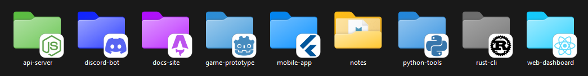
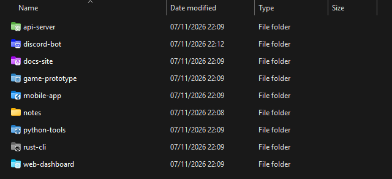
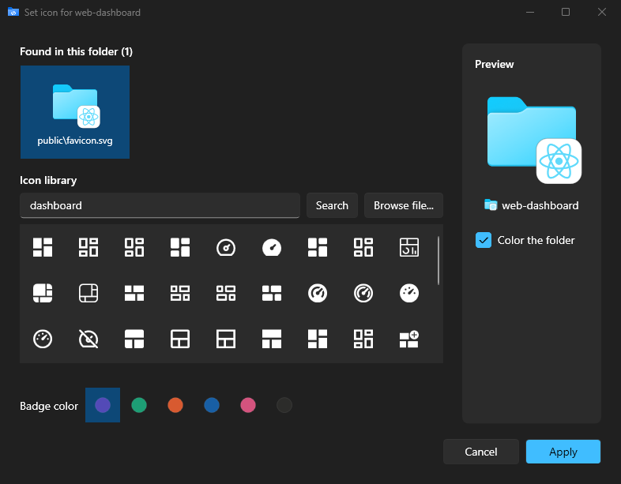
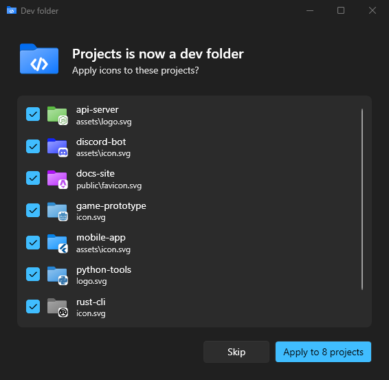

# DevFolders

Project icons for Windows Explorer folders. DevFolders finds a project's favicon, app icon or
logo, puts it in the corner of the folder and colors the folder to match.



Still recognizable in the details view:



## Install

Download `DevFolders-Setup-<version>.exe` from the
[latest release](../../releases/latest) and run it. It installs for the current user, no admin
rights needed, and adds DevFolders to the folder right-click menu.

On Windows 11 the menu is under **Show more options** (or Shift + right-click).

<details>
<summary>Build from source</summary>

Requires the [.NET 10 SDK](https://dotnet.microsoft.com/download).

```powershell
dotnet publish src/DevFolders -c Release -o "$env:LOCALAPPDATA\Programs\DevFolders"
& "$env:LOCALAPPDATA\Programs\DevFolders\DevFolders.exe" install
```

</details>

## Usage

Right-click a folder → **DevFolders**:

| Command | What it does |
| --- | --- |
| Use project icon | Applies the icon found in the folder, or opens the picker if there are several |
| Choose icon... | Pick a found icon, search the [Iconify](https://iconify.design) library, or browse for a file |
| Mark as dev folder | Gives a folder of projects its own look and badges the projects inside |
| Reset to default | Restores the folder exactly as it was |

| Icon picker | Mark as dev folder |
| --- | --- |
|  |  |


## Uninstall

Uninstall DevFolders from **Settings → Apps**. This removes the menu and resets every folder
it changed.

## Releasing

Bump `<Version>` in [`src/DevFolders/DevFolders.csproj`](src/DevFolders/DevFolders.csproj) and
push to `main`. The [release workflow](.github/workflows/release.yml) builds the installer and
publishes it as a GitHub release `v<version>`.
